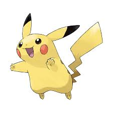
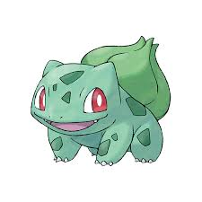

# 宝可梦对战（游玩时注意把终端放大以提升游戏体验）

这是一个基于命令行游玩的宝可梦对战游戏，玩家和电脑可以各自选择 3 名宝可梦（电脑随机选择）组成队伍，游戏开始时从 3 个宝可梦中选择一个出战，每个宝可梦拥有以下特性：

1. HP：此宝可梦的血量，当宝可梦的剩余 HP 小于等于 0 时，该宝可梦会【昏厥】
2. 属性：宝可梦的属性会影响克制关系和抗性。相同属性的宝可梦会拥有相同的属性被动，且属性会影响造成和受到的伤害
3. 攻击力：决定其对其他宝可梦的伤害
4. 防御力：来自其他宝可梦的伤害需要减去防御力的数值
5. 闪避率：在战斗中成功躲闪开敌人攻击的概率

| 属性 | 克制 | 被克制 | 属性被动                                 |
| ---- | ---- | ------ | ---------------------------------------- |
| 草   | 水   | 火     | 每回合回复 10% 最大 HP 值                |
| 火   | 草   | 水     | 每次造成伤害，叠加 10% 攻击力，最多 4 层 |
| 水   | 火   | 电     | 受到伤害时，有 50% 的几率减免 30% 的伤害 |
| 电   | 水   | 草     | 当成功躲闪时，可以立即使用一次技能       |
| 奶   |所有  | 无     | 克制所有其他属性                         |

被克制的宝可梦受到来自克制方的伤害时会翻倍；同时，被克制方对克制方造成的伤害会减半。
6. 招式：即技能，用来攻击对手的宝可梦，或者给对手的宝可梦附加各种各样的「效果」

## 下面是 本局游戏会用到 的 5 个宝可梦：

### - 皮卡丘（PikaChu）

HP：80 攻击力：35 防御力：5 属性：电 躲闪率：30%

十万伏特（Thunderbolt）：对敌人造成 1.4 倍攻击力的电属性伤害，并有 10% 概率使敌人麻痹

电光一闪（Quick Attack）：对敌人造成 1.0 倍攻击力的快速攻击（快速攻击有几率触发第二次攻击），10% 概率触发第二次

### - 妙蛙种子（Bulbasaur）

HP：100 攻击力：35 防御力：10 属性：草 躲闪率：10%

种子炸弹（Seed Bomb）：妙蛙种子发射一颗种子，爆炸后对敌方造成草属性伤害。若击中目标，目标有 15% 几率陷入「中毒」状态，每回合损失 10% 生命值

寄生种子（Parasitic Seeds）：妙蛙种子向对手播种，每回合吸取对手 10% 的最大生命值并恢复自己，效果持续 3 回合

### - 杰尼龟（Squirtle）

HP：80 攻击力：25 防御力：20 属性：水 躲闪率：20%

水枪（Aqua Jet）：杰尼龟喷射出一股强力的水流，对敌方造成 140% 水属性伤害

护盾（Shield）：杰尼龟使用水流形成保护盾，减少下一回合受到的伤害 50%

### - 小火龙（Charmander）

HP：80 攻击力：35 防御力：15 属性：火 躲闪率：10%

火花（Ember）：小火龙发射出一团小火焰，对敌人造成 100% 火属性伤害，并有 10% 的几率使目标陷入「烧伤」状态（每回合受到 10 额外伤害，持续 2 回合）

蓄能爆炎（Flame Charge）：小火龙召唤出强大的火焰，对敌人造成 300% 火属性伤害，并有 80% 的几率使敌人陷入「烧伤」状态。这个技能需要 1 个回合蓄力，并且在面对该技能时敌方闪避率增加 20%

### - 奶娃（Naiwa）

HP：100 攻击力：35 防御力：20 属性：奶 躲闪率：20%

捧腹大笑（pengfu）：奶娃发出捧腹大笑，回复自身至满状态，并提供一个护盾，减少下一回合受到的伤害 50%
 
惊鸿一瞥（yipie）：蓄力四个回合后发动惊鸿一瞥，将对方生命值清零

