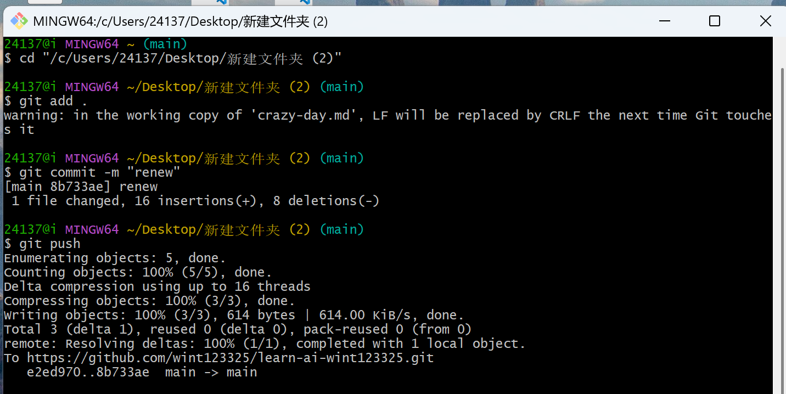

# SUCH A CRAZY DAY

## 一个悲伤的晚上




### 为什么悲伤

因为搞了一晚上 Git!  
但还要学 Markdown.......  
[Markdown 语法](https://markdown.com.cn)

#### 先写一段 Hello World  

```c
#include <stdio.h>
int main(void)
{

    printf("Hello World!\n");
    return 0;
}
```

##### 还有一个表格

| 1 | 2 | 3 | 4 |
| :--- | :--- | :--- | :--- |
| @ | # | $ | % |
| ^ | & | * | ~ |

***over***
