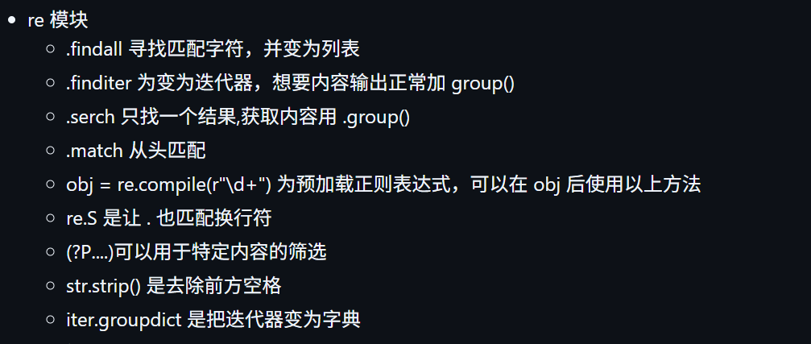

# Task 0 笔记

## 10月7日

### 晚上

- 学习markdown语法

- 完成 [**作业 2**](https://github.com/xyc9178/learn-ai-xyc9178)
- 学习 git clone [**忘了看这**](https://west2-online.feishu.cn/wiki/Zvqow0CUxig3iWkWQgBcHp4AnHe)

- 完成作业 3

- 正在完成作业 4...  
同行空格连续输入:`split()`

将列表合并为字符串: `'元素间隔'`.join(原列表)

## 10月8日

### 晚上

- 完成作业 4

替换字符串中元素: 字符串.replace(旧,新)

- 完成作业 5

- 完成 Bonus 1-6

## 10月9日

### 中午

- 学习面向对象完成 Bonus 7

- 完成 Bonus 7

### 晚上

- 学习装饰器完成进阶 1  

[万一以后要用呢](Bonus/advanced/1_decorator_name_time.py)

- 完成进阶 2

借鉴了舍友比大小思路，结合我的大芬本体

- 完成进阶 3

想力竭了，试了好多次，一直报错，最后发现行列搞反了

## 10月10日

### 中午

- 完成进阶 4

- 完成进阶 5

